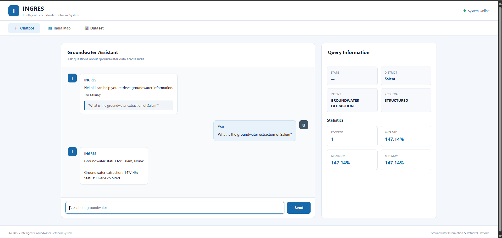
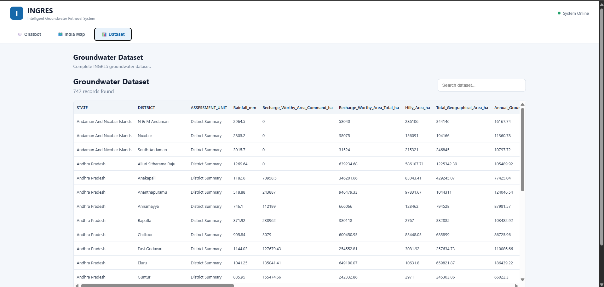

# 💧 Hydro-Trace
### INGRES — Intelligent Groundwater Retrieval System

An intelligent groundwater information platform that enables users to explore groundwater assessment data across India through natural-language queries, interactive geographical visualization, and a searchable dataset.

**Repository:** [krishnapandey06/Hydro-Trace](https://github.com/krishnapandey06/Hydro-Trace)

---

## 📌 Overview

Groundwater plays a vital role in India's drinking water supply, agriculture, and economic development. However, extracting meaningful insights from large groundwater assessment datasets can be challenging when information is distributed across numerous records and technical data fields.

**Hydro-Trace (INGRES)** aims to simplify groundwater information retrieval by combining structured data access, query processing, and an intuitive web interface.

The application provides three primary modules:

- **Groundwater Assistant:** Ask questions about groundwater conditions and retrieve relevant information.
- **India Groundwater Map:** Explore geographical groundwater classifications and district-level information.
- **Groundwater Dataset Explorer:** Search and browse groundwater assessment records.

## 🎯 Objectives

- Make groundwater assessment information easier to access and understand.
- Enable natural-language interaction with groundwater data.
- Visualize groundwater resource conditions geographically.
- Provide searchable access to structured groundwater datasets.
- Organize the application into modular data-processing, retrieval, backend, and frontend components.

## ✨ Key Features

### 💬 1. Groundwater Assistant

- Accepts groundwater-related questions in natural language.
- Retrieves relevant groundwater assessment information.
- Displays groundwater extraction percentages and resource classifications when available.
- Presents query information, including location, intent, and retrieval type.
- Displays statistics associated with retrieved records.

**Example query:**

> What is the groundwater extraction of Salem?

The demonstrated interface returns an extraction value of **147.14%** and classifies the location as **Over-Exploited**.



### 🗺️ 2. India Groundwater Map

- Provides a geographical view of groundwater assessment information.
- Highlights selected districts and locations.
- Displays location-specific groundwater extraction information.
- Uses a color-coded legend to represent groundwater status categories:
  - Safe
  - Semi-Critical
  - Critical
  - Over-Exploited
  - Unknown
- Supports interactive map navigation.


### 📊 3. Groundwater Dataset Explorer

- Displays the groundwater assessment dataset in a tabular format.
- Provides a searchable interface for exploring records.
- Includes geographical and hydrological attributes.
- Supports data exploration across states, districts, and assessment units.

The demonstrated interface contains **742 records**.



## 🏗️ System Architecture

The system is organized into data preparation, query processing, retrieval, and presentation layers.

```text
                USER
                  |
                  v
          WEB APPLICATION
                  |
          +-------+-------+
          |               |
          v               v
       CHATBOT         DATASET / MAP
          |
          v
      FASTAPI BACKEND
          |
          v
    QUERY PREPROCESSING
          |
          v
      INTENT ROUTER
          |
          v
    RETRIEVAL ENGINE
          |
      +---+---+
      |       |
      v       v
  STRUCTURED  SEMANTIC
  RETRIEVAL   RETRIEVAL
      |       |
      v       v
   DATABASE  VECTOR INDEX
      |       |
      +---+---+
          |
          v
   RETRIEVED INFORMATION
          |
          v
     USER RESPONSE
```

*The diagram illustrates the high-level design. The actual execution path depends on the implemented backend logic.*

## 🔄 Workflow

1. **Data preparation:** Groundwater data is cleaned and standardized.
2. **Data storage:** Prepared records are made available through the structured database.
3. **Query input:** A user submits a groundwater-related question.
4. **Preprocessing:** The query is normalized and prepared for processing.
5. **Intent detection:** The system identifies the intended type of information retrieval.
6. **Information retrieval:** The appropriate structured or semantic retrieval component is used.
7. **Response generation:** Retrieved information is presented through the application interface.
8. **Visualization:** Users can explore available records and geographical groundwater classifications through the dataset and map modules.

## 🛠️ Technology Stack

| Component | Technologies |
|---|---|
| Programming Language | Python, JavaScript |
| Backend Framework | FastAPI |
| Backend Server | Uvicorn |
| Data Processing | Pandas, NumPy |
| Machine Learning Utilities | Scikit-learn |
| Structured Database | SQLite |
| Vector Database | ChromaDB |
| Semantic Retrieval | Sentence Transformers |
| Text Processing | NLTK |
| Frontend | HTML, CSS, JavaScript |
| Interactive Maps | Leaflet |
| Map Data | OpenStreetMap |
| Version Control | Git, GitHub |

## 📂 Project Structure

```text
Hydro-Trace/
│
├── data/
│   ├── INGRES_Averaged_Groundwater_Dataset.csv
│   ├── INGRES_Step1_Cleaned_Dataset.csv
│   └── ingres_groundwater.db
│
├── src/
│   ├── database_engine.py
│   ├── datacleaning.py
│   ├── intent_router.py
│   ├── preprocessing.py
│   └── vector_rag.py
│
├── web/
│   ├── backend/
│   │   └── api.py
│   └── frontend/
│       └── app.js
│
├── screenshots/
│   ├── chatbot.png
│   ├── dataset.png
│   └── india map.png
│
├── requirements.txt
└── README.md
```

*This is a representative project structure. Additional files, configuration files, frontend assets, and generated indexes may also be present in the repository.*

## ⚙️ Installation and Setup

### Prerequisites

- Python 3.10 or later
- Git
- pip

### 1. Clone the repository

```bash
git clone https://github.com/krishnapandey06/Hydro-Trace.git
cd Hydro-Trace
```

### 2. Create a virtual environment

**Windows**

```bash
python -m venv .venv
.venv\Scripts\activate
```

**Linux / macOS**

```bash
python3 -m venv .venv
source .venv/bin/activate
```

### 3. Install dependencies

```bash
python -m pip install --upgrade pip
pip install -r requirements.txt
```

### 4. Start the backend

The backend module is located at `web/backend/api.py`. The following command assumes that the FastAPI application object inside that file is named `app`:

```bash
uvicorn web.backend.api:app --reload
```

If the application object has a different name, replace `app` with the correct object name.

When the server starts successfully, open the API documentation at:

[http://127.0.0.1:8000/docs](http://127.0.0.1:8000/docs)

### 5. Open the frontend

Open the project's frontend entry page using the development server or startup procedure configured in the repository.

Ensure that the frontend API URL matches the address where the backend is running.

*Note: The exact frontend startup command depends on the files and configuration included in the repository.*

## 💡 Example Queries

Users can ask questions such as:

- What is the groundwater extraction of Salem?
- Which groundwater assessment records are available for a district?
- What is the groundwater status of a selected location?
- Show the groundwater assessment data for a particular state.
- Find records associated with groundwater recharge.
- Search the dataset for a particular district or assessment unit.

Supported queries depend on the available dataset fields and the backend's implemented retrieval capabilities.

## 🌱 Applications

Hydro-Trace can support:

- Groundwater data exploration and analysis.
- Geographical exploration of groundwater conditions.
- Access to groundwater assessment records.
- Educational and research activities related to water resources.
- Data-informed understanding of groundwater resource classifications.

The application is an information retrieval and visualization tool; its outputs should be interpreted in the context of the underlying dataset and assessment methodology.

## 🚀 Future Enhancements

Potential extensions include:

- Advanced groundwater trend analysis.
- Historical comparisons across assessment years.
- More comprehensive district-level visualizations.
- Improved natural-language query interpretation.
- Source-level citations for retrieved records.
- Multilingual query support.
- Automated evaluation of retrieval accuracy.
- Cloud deployment and performance monitoring.

These items represent possible future work rather than claims about existing functionality.

## 🤝 Contributing

Contributions, suggestions, and improvements are welcome.

1. Fork the repository.
2. Create a feature branch.
3. Make and test your changes.
4. Commit your changes with a descriptive message.
5. Submit a pull request.

## 👨‍💻 Author

**Krishna Pandey**

GitHub: [@krishnapandey06](https://github.com/krishnapandey06)

## 📄 License

A license has not been specified in this README. Please add an appropriate `LICENSE` file if you intend to distribute the project under an open-source license.

---

**Hydro-Trace (INGRES)**

*Making groundwater information across India easier to access, explore, and understand.*
